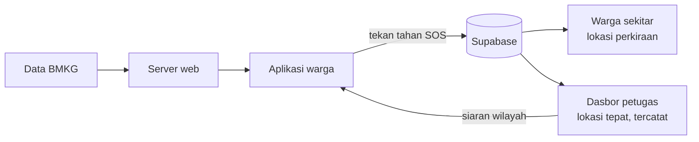

<p align="center">
  
</p>

<h3 align="center">Tahu apa yang terjadi. Tahu ke mana harus pergi.</h3>

<p align="center">
  Aplikasi kesiapsiagaan bencana untuk warga Indonesia.<br>
  Peringatan untuk wilayahmu, peta evakuasi yang tetap terbuka saat sinyal hilang, dan tombol SOS yang langsung terpantau petugas wilayah.
</p>

<p align="center">
  
  
  
  
</p>

<p align="center">
  <a href="#kenapa-wero">Kenapa Wero</a> ·
  <a href="#yang-bisa-dilakukan">Fitur</a> ·
  <a href="#dasbor-petugas">Dasbor petugas</a> ·
  <a href="#menjalankan-di-komputer-sendiri">Menjalankan</a> ·
  <a href="#deploy">Deploy</a>
</p>

<br>

## Kenapa Wero

Indonesia hidup berdampingan dengan gempa, banjir, tsunami, dan longsor. Saat bencana datang, masalahnya sering bukan kurang informasi, tapi informasinya datang terlambat, tidak relevan dengan lokasi kita, atau hilang begitu sinyal putus.

Di jam-jam pertama, bantuan resmi sering belum tiba. Orang yang paling dekat dengan korban biasanya tetangganya sendiri. Wero dibuat untuk menjembatani dua hal itu. Warga dibantu untuk tahu harus berbuat apa dan ke mana, sementara petugas wilayah bisa melihat siapa yang butuh pertolongan tanpa membuka data pribadi ke sembarang orang.

## Yang bisa dilakukan

| Fitur | Yang terjadi di aplikasi |
| :--- | :--- |
| **Peringatan sesuai lokasi** | Gempa terbaru dari BMKG dan siaran resmi petugas untuk wilayah yang dipilih pengguna, lengkap dengan tingkat status (AWAS, SIAGA, WASPADA) dan langkah yang perlu dilakukan. |
| **Peta evakuasi offline** | Titik kumpul, shelter, dan fasilitas kesehatan diunduh saat ada sinyal, lalu tetap bisa dibuka saat jaringan mati. |
| **SOS** | Tekan tahan untuk meminta bantuan, mode publik atau privat. GPS wajib aktif, dan lokasi tepat hanya terbuka untuk petugas wilayah yang berwenang. |
| **Asisten bencana** | Tanya cara menghadapi gempa atau banjir. Jawaban mengikuti protokol BNPB, BMKG, dan Basarnas, dan tetap ada panduan statis saat offline. |

Selain itu ada feed komunitas lokal dengan moderasi, check-in keselamatan keluarga, daftar nomor darurat, dan checklist tas siaga.

## Dasbor petugas

Bagian web punya dua wajah. Halaman publik di `/` menjelaskan aplikasi dan menyediakan unduhan APK, lengkap dengan ilustrasi 3D kota pesisir untuk skenario gempa, tsunami, dan banjir. Dasbor di `/admin` khusus untuk petugas wilayah.

- **Ringkasan.** SOS yang menunggu penolong selalu di paling atas, ditambah angka singkat dan aktivitas terbaru.
- **Pemantauan SOS.** Peta dan daftar kasus berdampingan. Peta hanya menunjukkan lokasi perkiraan. Lokasi tepat baru terbuka saat kasus dibuka, dan pembukaannya tercatat.
- **Titik evakuasi.** Tambah atau ubah titik langsung dari peta. Penghapusan selalu minta konfirmasi.
- **Siaran peringatan.** Draf, pratinjau notifikasi, lalu konfirmasi. Admin wilayah hanya bisa menyiarkan ke wilayahnya sendiri.
- **Moderasi komunitas.** Tinjau unggahan yang dilaporkan warga.
- **Log audit.** Setiap tindakan sensitif tercatat dengan rantai hash, jadi perubahan diam-diam bisa ketahuan.

Akses diatur lewat peran di tabel `user_roles`. `SUPER_ADMIN` melihat semua wilayah, `GOVERNMENT_ADMIN` hanya wilayahnya ditambah zona penyangga di perbatasan, dan `COMMUNITY_MODERATOR` hanya antrean moderasi.

## Cara kerjanya



## Isi repositori

```
wero/
├── lib/                      aplikasi Flutter (Android, iOS, web)
├── assets/                   logo dan gambar aplikasi
├── test/                     pengujian Flutter
├── web/                      Next.js, halaman publik, dasbor petugas, dan API
│   ├── src/app/admin/        dasbor petugas
│   ├── src/app/api/          API untuk aplikasi dan dasbor
│   └── src/components/       komponen UI, peta, dan ilustrasi 3D
├── supabase/
│   ├── migrations/           skema database, RLS, dan fungsi
│   └── admin_roles_setup.sql pemberian peran petugas, dijalankan manual
└── siagaku_design_skills/    pedoman desain yang dipakai untuk UI
```

Dibangun dengan Flutter, Riverpod, dan flutter_map di sisi aplikasi. Bagian web memakai Next.js 16, React 19, Tailwind CSS 4, MapLibre, dan Three.js. Data disimpan di Supabase (PostgreSQL dan PostGIS), notifikasi lewat Firebase Cloud Messaging, dan asisten memakai Gemini lewat server, jadi kuncinya tidak pernah ada di aplikasi.

## Menjalankan di komputer sendiri

Yang dibutuhkan: Flutter 3.24 atau lebih baru, Node.js 20 atau lebih baru, dan project Supabase.

**Web dan API**

```bash
cd web
npm install
cp .env.example .env.local
npm run dev
```

Isi `.env.local` sesuai keterangan di `web/.env.example`. Minimal `NEXT_PUBLIC_SUPABASE_URL`, `NEXT_PUBLIC_SUPABASE_ANON_KEY`, dan `DATABASE_URL`. Halaman publik terbuka di `http://localhost:3000` dan dasbor di `http://localhost:3000/admin`.

Supaya bisa masuk dasbor, beri peran ke akun petugas dengan menjalankan `supabase/admin_roles_setup.sql` di SQL editor Supabase. Ganti dulu email dan kode wilayah di dalamnya.

**Aplikasi**

```bash
flutter pub get
flutter run --dart-define=BACKEND_URL=http://10.0.2.2:3000
```

`10.0.2.2` adalah alamat komputer kita dari dalam emulator Android. Untuk perangkat fisik, ganti dengan IP komputer di jaringan yang sama. Tanpa `BACKEND_URL`, aplikasi memakai alamat produksi yang tertulis di `lib/core/config/app_config.dart`. Nilai `SUPABASE_URL` dan `SUPABASE_ANON_KEY` juga bisa diganti lewat `--dart-define`.

## Deploy

Web dideploy ke Vercel dengan **Root Directory** diisi `web`. Pengaturan framework dan build bisa dibiarkan default. Masukkan variabel dari `web/.env.example` ke Environment Variables. Untuk `DATABASE_URL`, pakai connection pooler Supabase mode transaction (port 6543) karena lebih cocok untuk serverless.

Setelah domain Vercel jadi, perbarui `BACKEND_URL` di aplikasi lalu build ulang APK, supaya asisten, data BMKG, dan deteksi wilayah mengarah ke server yang benar.

## Soal privasi

Lokasi saat darurat adalah data yang sangat sensitif, jadi Wero memperlakukannya dengan hati-hati.

- Koordinat tepat disimpan terpisah dari lokasi perkiraan. Dasbor hanya menampilkan perkiraan sampai petugas membuka kasusnya.
- Petugas hanya melihat kasus di wilayah tugasnya, dan setiap pembukaan lokasi tepat tercatat atas nama petugas itu.
- Kunci rahasia seperti kredensial database dan kunci Gemini hanya ada di server, dibaca dari environment variable.
- Asisten tidak menggantikan petugas. Dalam keadaan darurat, tetap hubungi **112** dan ikuti arahan petugas setempat.

<br>

<p align="center">
  <br>
  <sub>Wero. Tanggap bersama, selamatkan sesama.</sub>
</p>
